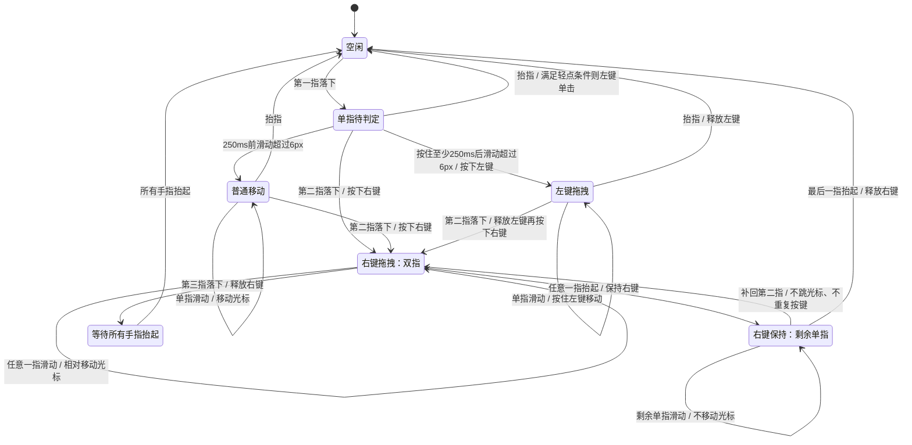

# GTNH Easy Touch

**0.4.70 数量按钮缩小为单列，从上到下为大加、小加、小减、大减；移除数量控件的悬停提示。**

**0.4.69 数量按钮按配方产出动态显示：一批产出 5 个时为 `+5 / -5 / +65 / -65`，长按也按对应数量连续调整。**

**0.4.68 Shift+T 和触摸菜单“合成”打开的临时树，初始目标自动设为超过现有库存的下一个配方批次。**

**0.4.67 配方树数量滚轮替换为 `+1 / -1 / +64 / -64` 四个按钮，支持鼠标和触控长按连续调整。**

**0.4.66 修复数量滚轮事件类可见性导致首次触摸后 GUI 渲染崩溃（IllegalAccessError）。**

**0.4.65 配方树左侧新增制作数量滚轮：支持触控/鼠标上下拖动、鼠标滚轮和轻点调节；多目标时点顶部物品切换。**

**0.4.64 配方树根节点上方新增“已有数量 + 目标差额”显示，仅改展示，不改变目标量、配方选择或合成计算。**

**0.4.59 右下角新增“主／副”切换按钮，选择自动保存。副键模式下，世界内轻触使用 Smart 副键；世界内长按始终持续左键攻击/挖掘，不受主／副选择、Smart 或准星目标影响，松手释放。普通 GUI 触摸改用右键点击与拖拽。**

给 GTNH 2.9 / Minecraft 1.7.10 Forge 提供客户端触屏操作优化，主要用于 UU 远程。无需服务端安装。

**0.4.57 每次启动 Minecraft 后，所有功能等待首次原生触摸输入才启用（包括触屏按键、HUD、输入接管与 NEI 扩展）。普通鼠标、鼠标模拟触点和窗口切换不会启用；首次触摸本身正常处理，退出世界后仍保持启用，重启游戏后重新等待。`touch.enabled=false` 时保持停用。**

**0.4.42 世界内触摸底部快捷栏立即切换手持物品；该触点长按或滑出不会触发挖掘、交互或转动视角。隐藏自定义按键时仍可使用，隐藏 HUD 时停用。**

**0.4.41 手持格雷工具且目标为格雷方块时临时禁用 smart，优先于用户自定义规则；换工具或目标后自动恢复。**

**0.4.40 世界内静止长按 0.25 秒固定持续挖掘/攻击，长按后拖动视角仍保持按下，松手才释放。轻触继续遵循 smart 规则，直接滑动仍只转动视角。**

**0.4.39 背包与容器槽位的物品支持长按 0.25 秒打开菜单：详情、拆分、NEI。NEI 子菜单提供来源、用途、书签、合成以及返回。短按保留普通取放，拖拽保留鼠标拖拽；拆分走原生右键取物流程，数量不足或槽位不可取时置灰，光标持有物品时保留普通放置操作。**

**0.4.38 移除 NEI 长按菜单中的“详情”，物品详情通过轻触悬停查看。物品栏菜单保留来源、用途、书签、合成；配方物品菜单保留来源、用途、书签。**

**0.4.37 NEI 左右物品栏与配方物品统一使用轻触悬停、长按菜单、拖拽模拟鼠标拖拽。长按阈值统一为 0.25 秒（包括世界内长按）；手指移动超过屏幕短边 1% 后进入拖拽，松手释放鼠标。长按菜单打开后本次触摸不再触发拖拽。**

**0.4.36 NEI 配方界面的物品改为轻触移动光标显示悬停提示，静止长按 0.5 秒打开菜单。配方菜单保留详情、来源、用途、书签，移除收藏/使用；左右物品栏仍然轻触打开菜单。**

**0.4.35 NEI 配方界面的材料和输出物品支持触摸菜单，不显示“合成”；输出额外提供“收藏”和“使用”，分别调用该条配方原生的心形和下箭头按钮。原生按钮不可用时对应菜单项置灰。左右物品栏仍保留“合成”。**

**0.4.34 NEI 物品触摸菜单新增“合成”，沿用 Shift+T 按收藏配方创建合成组并打开配方树的逻辑；没有有效收藏配方时不创建分组。此按钮只打开配方树，实际合成仍在树内操作。**

**0.4.33 新增 NEI 左右物品栏触摸菜单：详情（悬停）、来源（R）、用途（U）、书签（A）。点击菜单外关闭，并吞掉本次触摸以避免误操作。书签沿用 NEI 的添加/移除行为。**

**0.4.32 移除“选择下一个”，修复返回布局时同一次点击误触新页面按钮的问题。映射编辑器的工具栏、属性和子选项统一使用整块可点击的文字按钮。两种弹出菜单行高缩至 22，选项间增加清晰分割线；保留深色背景，按文字实际宽度自适应尺寸；映射菜单移除关闭项，点击外部收起。布局编辑、属性返回及虚拟键盘操作统一放在屏幕顶部，窄屏工具栏自动换行。统一接管 SDL 原生触摸：世界内支持轻触、静止长按和拖拽视角，GUI 内模拟普通左键点击与拖动。smart 仅影响触摸动作，真实鼠标左右键保持原版。要求 lwjgl3ify 3.0.37+ 和可用的 SDL3 后端，适配 GTNH 2.9.0 RC2 现代 Java 版。**

## 安装与使用

1. 使用 GTNH 2.9.0 RC2 现代 Java 版（自带 lwjgl3ify 3.0.37 和 SDL3），将 `build/libs/gtnh-easy-touch-0.4.39.jar` 放入客户端的 `mods/`，并移除旧版 Easy Touch jar。不要安装 `-sources.jar` 或 `-dev.jar`。
2. 在串流软件中开启原生触点透传；模组不依赖串流软件额外模拟鼠标点击。真实鼠标或串流按键发送的左右键保持原版行为。
3. 点击右下角全局菜单切换 smart、显示/隐藏触屏按键或配置映射。本模组不再向游戏控制菜单注册快捷键。

触摸 smart 默认开启。切换状态保存到 `config/gtnheasytouch.cfg`；关闭后世界内触摸点击与长按执行攻击/挖掘，拖拽仍控制视角。开启时，命中白名单目标的轻触执行使用/交互；长按始终执行攻击/挖掘。普通 GUI 触摸默认模拟鼠标左键；右下角“主／副”按钮可切换为右键，世界内轻触则改用 Smart 副键。选择会保存；世界内长按始终持续左键攻击/挖掘，不受主／副选择、Smart 或准星目标影响，松手释放；NEI 专用触摸菜单和触摸板手势保持原有规则。攻击/使用改绑后仍通过对应的游戏按键执行触摸动作。

世界模式左下方显示 WASD 轮盘：按住方向持续移动，斜向支持两个方向同时移动，滑回中心停步，松手停止。左手移动时可用另一根手指拖动视角。轮盘沿用游戏前后左右按键绑定，不受 smart 开关影响；打开 GUI、失焦或隐藏 HUD 时释放移动。需要原生触点透传。

玩家处于潜行状态（默认按住 Shift）时，新触摸动作执行攻击/挖掘，即使目标在白名单中也不转为交互；准星旁的“交互”提示同时隐藏。依据 `player.isSneaking()` 判断。世界内长按始终保持攻击/挖掘，不受 smart 或潜行状态影响。

## 自定义触屏按键

点击游戏右下角的小菜单按钮，向上展开全局控制菜单；世界、背包、机器和其他 GUI 中都可使用：

- **Smart: 开启/关闭**：直接切换 smart 模式，立即保存。
- **隐藏/显示所有按键**：统一控制自定义触屏按键和 WASD 轮盘，右下角菜单按钮自身始终保留。隐藏时释放正在按住的输入；重新显示遵循各按键原有的世界/其他规则，不改写布局。开关保存在 `config/gtnheasytouch.cfg` 的 `touch.showButtons`，重启后保留。
- **配置按键映射**：进入布局编辑器。原暂停菜单入口和“编辑触屏按键布局”快捷键已移除，仍可用 `/easytouch layout` 直接打开。

菜单项在手指抬起时执行；点击外部收起菜单，该次触摸不会穿透到游戏或 GUI。菜单打开时释放当前触摸操作。布局编辑器只负责布局与单个按键属性；即使全局隐藏按键，也可在编辑器中预览和修改。

- 点“新增”后打开映射，使用虚拟键盘点选一个或多个键，再点“确定”文字按钮。已选键高亮，再点一次取消；“清空”重选，“数字/导航”切换数字小键盘与导航键页。支持 Shift+T、Ctrl+R 等组合键，也支持多个普通键；选择只在确认后生效；主键盘及数字/导航页末尾的“左 / 右 / 中”对应鼠标左、右、中键，可与键盘键组合，例如 Shift+鼠标左键。清空后也可以确认保存空映射。
- **Smart 副键**：首次使用或升级旧布局时补上一个“副”按钮，也可在虚拟键盘右上角点“副”选择该动作。它是独立动作，不能与普通键组合，默认只在世界显示；可移动、修改外观、切换按住/切换模式或删除。保存删除后不会自动补回。
- 副键按下时与当前 smart 主动作相反：主动作交互时执行攻击，主动作攻击时执行使用。按住 Shift、潜行或 smart 关闭时执行使用/右键。沿用游戏攻击/使用绑定；按住或切换保持期间锁定动作，目标变化不会中途换键，重新激活时才重新判断。GUI 中不显示副键。
- 新映射保存具体键码；旧的游戏功能映射仍可使用，重新编辑并确认后转为具体键码组合。按键未绑定或已移除时显示红色 `!`。
- 触屏按钮和虚拟键盘键帽均为圆形，命中区域与圆形一致。外围有细环边框，按下/保持状态以绿色环高亮，编辑选中时为金色环；按钮文字缩至 80%。圆形填充和边框使用连续几何与约一个屏幕像素的透明过渡，不再按 GUI 像素画台阶；轮盘同步改用该渲染。文字仍使用 Minecraft 原有字体，仅将绘制起点对齐真实屏幕像素，保留像素字体风格。编辑器的工具栏、属性、子选项列表及确认/取消均为带深色背景、细边框和居中文字的矩形按钮，整个按钮区域都可点击，悬停高亮；右下角菜单向上展开三个文字选项，直接点击对应文字行选择。新触屏键默认不透明度为 30%；旧布局默认的 55% 自动迁移为 30%，其他自定义透明度保留。
- **弹出菜单**：在按键属性中点“触发”切换到“弹出菜单”，再点“配置子选项”新增、编辑或删除项目。每项可单独命名并配置单键、组合键、鼠标键或 Smart 副键。保存后轻触菜单按键，在该按键附近展开文字列表（优先向上，空间不足时调整位置）；点选子选项并抬手后按下、释放一次，随后收起菜单；长按不连发。直接点击文字行选择，菜单统一使用深色背景与细边框，按最长文字宽度加内边距自动适配（超宽时限制在屏幕内）；无独立按钮图标或全屏遮罩，点击外部取消，不向底层传递点击；多项时支持翻页，空菜单显示配置提示。子选项不使用按住/切换模式，菜单沿用父按钮的世界/其他显示设置。
- 新建按键默认大小为 24、映射为空，不再预选 Space。可修改名称、大小、不透明度和触发方式：按住触发、点击切换、弹出菜单。旧版“点按一次”自动迁移为按住触发，已有显式 Space 映射保留。切换按住时按钮高亮，再点一次释放。
- “世界”和“其他”独立控制显示：世界表示未打开 GUI 的游戏画面；其他表示背包、机器、NEI、聊天、菜单等 GUI。可同时开启，也可全部关闭以保留但隐藏按钮。
- 编辑操作统一放在屏幕顶部：布局页提供新增、编辑、删除、预览、保存和取消，窄屏自动换行；属性页顶部返回布局，虚拟键盘顶部切换键盘、清空、确定和取消。
- 在布局画面点击选中并拖动位置，“编辑”修改属性，“删除”移除按钮。直接点击画面中的按钮或 WASD 轮盘进行选择；轮盘支持移动、缩放、隐藏。
- “预览”切换世界/其他布局；同一按钮在两种模式共用位置，需要不同位置时可分别新增两个按钮。按键重叠时最后新增的按钮优先。
- 点“保存”立即生效，写入 `config/gtnheasytouch-layout.json`；“取消”或布局页 Esc 放弃草稿。首次使用会有一个“副”按钮，原轮盘保持显示。

触屏按钮优先接收触点，按住后手指滑出仍归原按钮处理，松手释放，支持与轮盘和视角同时操作；按钮不向底层 GUI 发送鼠标点击。切换界面、失焦、死亡、隐藏世界 HUD 或触点重置会清理按键状态，切换按住也会重置。

GUI 通过 lwjgl3ify 键盘事件队列接收组合键：先按下修饰键、再按普通键，释放时反向处理。虚拟按键状态与实体键盘状态合并，供 GUI 的 Shift/Ctrl 判断使用；多个触屏按钮共享修饰键时，最后一个按钮松开才释放。按住触发、点击切换均支持组合键；切换界面、失焦和触点重置会清理整个组合。尚未提供宏、输入法或自动连发。GUI 的 R/U 等悬停快捷键使用当前鼠标指向的物品，先触摸定位物品，再点自定义按键。

## 多点触控转发与检测

使用 GTNH 现代 Java 版的 lwjgl3ify 3.x，在进入世界后执行客户端命令 **`/easytouch touch`**。命令不需要 OP，也不发送给服务器。打开页面后，用两根手指同时按住并分别移动：

- 监听状态应为“已连接”；`DOWN / MOVE / UP / CANCEL` 显示 SDL 是否启用了相应事件。
- 绿色十字和手指编号表示 SDL 原生触点。当前触点数达到 2，且两个标记能独立移动，表示当前输入链路确实送来了独立的多指数据。抬起后当前数量应减少。
- 灰色 `[MOUSE]` 标记表示 SDL 从鼠标模拟的触点，不计入原生触点数量或峰值。
- “鼠标事件”在变化而原生触点始终为 0 时，先检查上方 SDL 事件开关，再检查串流软件的触点透传；单凭这个现象不能断定 UU 的所有模式都不支持。
- “重置触点统计”清除触点事件计数、最后事件及历史峰值，仍按住的触点继续显示；鼠标和队列丢弃数统计整个监听会话。按 Esc 或“完成”退出。

世界内由第一根原生触点控制手势，其他手指不会抢占：

- 按下时先不点击；在 250ms 内松开且移动始终不超过屏幕短边的 1%，触发一次点击。
- 移动超过短边的 1% 后进入拖拽，仅转动视角，沿用游戏鼠标灵敏度和反转设置；返回起点或松手也不补发点击。
- 静止按住达到 500ms 后开始持续按键，松手释放；之后移动超过阈值会释放按键并进入拖拽。
- 250～500ms 之间松开且未拖动，不触发操作。
- 菜单、背包、机器、NEI、聊天和触点调试页中，按下立即定位鼠标并按住左键，移动可拖动，抬起释放；不应用世界内的阈值或 smart。

切换界面、失焦、死亡、退出世界或触点重置会取消当前手势，恢复后需重新按下。SDL 自动生成的触摸鼠标事件统一过滤，避免重复点击或双倍转向；鼠标模拟的触点不参与手势，真实鼠标不交换左右键。`touch.enabled=false` 关闭触摸接管和过滤，恢复 SDL 原有输入。

触摸拖拽灵敏度在已有配置文件 `config/gtnheasytouch.cfg` 的 `touch` 分类中设置，启动新版后会自动补上默认项，不需要删除旧配置。退出游戏后编辑，重启生效：

```text
touch {
    D:dragSensitivity=1.0
}
```

范围为 `0.1`～`5.0`：`1.0` 保持当前速度，`0.5` 为半速，`2.0` 为两倍速度。它在游戏鼠标灵敏度基础上乘以该倍率，仅影响世界内触摸拖拽；真实鼠标、GUI 触摸定位、点击/长按时间和拖拽判定阈值不受影响。越界值限制到范围内，无效数字恢复为 `1.0`。

`config/gtnheasytouch.cfg` 的 `touch` 分类：`B:enabled=true` 默认启用触摸接管，`B:logEvents=false` 默认不逐条记录。关闭转发仍要求 lwjgl3ify 和 SDL3 可用。需要排查时可退出游戏，把 `logEvents` 改为 `true` 后重启；日志中的 `[Touch]` 会记录按下、抬起、取消和状态清理，移动事件不刷日志。运行中的回调异常会记录错误、释放触点状态并停用转发，避免 Java 异常跨越原生回调边界。

接入使用 SDL3 的 [`SDL_AddEventWatch`](https://wiki.libsdl.org/SDL3/SDL_AddEventWatch) 复制原生触点，并使用 [`SDL_SetEventFilter`](https://wiki.libsdl.org/SDL3/SDL_SetEventFilter) 过滤当前窗口中来源为 `SDL_TOUCH_MOUSEID` 的模拟鼠标事件；保留原有事件过滤器调用链。SDL 内部按下/松开状态继续更新，不在 GUI 切换时反复开关模拟功能。客户端 tick 开始时先转发触点，再执行手势判定；GUI 鼠标事件直接进入 lwjgl3ify 的鼠标队列，不回送 SDL。物理按钮单独记录，防止过滤掉的模拟左键通过底层状态恢复成按住。没有修改 lwjgl3ify 的字节码或磁盘 jar，也没有另起事件轮询。

原生回调可能来自其他线程，因此先复制数据进入有界队列，再于 MC 客户端 tick 发布 `MinecraftForge.EVENT_BUS` 上的 [TouchInputEvent](src/main/java/io/github/wdy/easytouch/touch/TouchInputEvent.java)。该事件不可取消，只转发数据；坐标原点在窗口左上角，通常范围为 0..1，允许边界外坐标。失焦、切换世界、队列溢出或接口错误时发布 `RESET`，消费者应清除全部按住状态。模拟鼠标触点通过 `sample.simulated()` 区分。触控代码直接使用 `SDL_Event`、`SDL_TouchFingerEvent`、`SDL_EventFilter` 和 `Display.sdlWindowId`；lwjgl3ify、LWJGL3 的 Java 绑定作为 `compileOnly` 依赖，运行时由整合包提供，不把依赖或原生库打入 mod。

`TouchInput` 和 `SdlTouchSource` 使用 `@Lwjgl3Aware`，防止 lwjgl3ify 的 [LWJGL2 重定向器](https://github.com/GTNewHorizons/lwjgl3ify/blob/3.0.37/src/main/java/me/eigenraven/lwjgl3ify/rfb/transformers/LwjglRedirectTransformer.java) 将 `org.lwjgl.sdl.*` 改写为不存在的 `org.lwjglx.sdl.*`。带此标记的 `TouchInput` 显式使用 `org.lwjglx.input.Mouse` 和 `org.lwjglx.opengl.Display`；其他类仍保留正常的 LWJGL2 兼容重写。如果旧版出现上述缺类错误，替换 Easy Touch jar 即可修复这处包名错误，无需额外安装 SDL jar。

## 已有目标匹配覆盖规则

目标匹配切换快捷键已移除；之前保存的手动规则继续生效。

作用范围为同类目标，保存于 `config/gtnheasytouch.cfg` 的 `target_overrides.allow` / `target_overrides.deny`，重启和切换存档后继续生效。手持格雷工具且目标为格雷方块时强制禁用 smart，优先于手动规则；其余情况下手动规则优先于所有内置 matcher，不改写原来的白名单；即使床接口、GT/AE2 规则等仍然命中，手动禁用也能生效。手动编辑两份列表时如有冲突，禁用优先；退出游戏后从两份列表都删除对应条目可恢复默认规则。

方块优先按 Forge“选取方块”的物品注册名和变体识别，因此朝向、位置、物品数量、容器内容和自定义名称不改变规则。GT 设备使用其机器编号，AE2 使用指向的部件，终端不会连带切换线缆；无法返回选取物品的方块退回精确方块注册名和世界元数据。规则不按坐标保存，也不区分仅由 NBT 表示的外观差异。这里仅调用选取结果查询，不给玩家物品，也不执行方块交互。

实体按种类识别，玩家归入同一类，不按 UUID 或自定义名称区分。同种实体的手动规则也覆盖驯服等默认条件，例如关闭狼会同时影响野狼和宠物狼。没有实体注册名时使用精确实体类名。

## 配方树合成按钮

独立的“打开 NEI 合成树（等效 Shift+T）”快捷键已移除，继续使用 NEI 自带的 Shift+T。

悬停书签、右侧 NEI 物品列表、中间配方的产物/材料或背包槽位中的物品，按 **Shift+T**，即可使用该物品的收藏配方直接打开临时配方树，不向书签页添加合成组。优先使用爱心手动收藏的配方，其次使用 NEI 自动收藏的配方；只有物品收藏标记、没有配方或原配方已失效时不新增合成组。匹配遵循 NEI 自己的物品、元数据、NBT 和流体规则。

临时树打开时，按原容器可取用槽位中的已有成品数量，选择目标产量严格高于库存的最小配方批次数。例如每批 4 个，已有 10 个时目标为 12，已有 12 个时目标为 16，没有库存时为一批。按 NEI 原有产出数量与流体/容器单位换算；达到原生批次数上限时封顶，没有有效原容器时保留默认数量。仅在新建临时树时初始化一次，后续 `+1/-1/+64/-64` 手动调整、窗口大小变化、已有书签树及实际合成逻辑保持原规则。

通过物品快捷键或触摸菜单创建合成树时，会将最初选择的配方固定为目标产物；例如“燧石 → 燧石臼 → 燧石”的循环依赖不会再把目标反转成燧石臼。目标保留在临时树中，数量调整与实际合成使用同一目标。循环中的起始材料仍需自行提供。

此操作复用 NEI 的收藏配方展开逻辑：按收藏递归展开原料、遵循展开深度与候选材料设置，再用独立的内存合成组打开原生配方树。每次打开创建新的临时树，不添加、覆盖或保存书签，也不会直接执行合成。快捷键沿用 NEI 的“打开合成树”绑定（默认 T，加 Shift）；搜索框输入优先，长按重复事件不创建新树。原生爱心按钮上的 Shift+T 同样打开临时树；收藏点击、Shift+A 保存配方及已有书签组的打开操作保持原有行为。

临时树提供“合成”和“尝试合成”两个操作按钮，退出使用原生返回操作，不提供分享书签组功能。合成保留完整配方链和容器同步等待；返回容器时不提前清除待执行的计算数据。临时数据不写入书签文件。

配方树左侧提供单列小尺寸数量按钮，不显示悬停提示。从上到下依次为大加、小加、小减、大减；小步长为一批产出，大步长按最少完整批次覆盖至少 64 个。每批产出 5 个时显示 `+65 / +5 / -5 / -65`，每批 4 个时为 `+64 / +4 / -4 / -64`，每批 128 个时为 `+128 / +128 / -128 / -128`。按下立即调整一次，按住 0.4 秒后每 0.1 秒重复；松手、移出原按钮、关闭界面、调整窗口大小或失焦立即停止，不滑动切换到其他按钮。主键和副键触控均可使用。顶部物品图标表示当前目标，有多个目标时轻点图标切换，按钮数量随之更新。单批预计产出被 NEI 取整为 0 时退回批次数显示（`x`）。按钮显示产出数量，内部仍按完整配方批次调整，不受 Alt 等修饰键影响；沿用 NEI 的上下限，刷新树、材料统计和按钮状态，不直接启动合成。

根节点上方显示 `已有 x + 待补 y`，其中 `y = max(目标量 - 已有量, 0)`。例如已有 20、目标 28，显示 `20 + 8`；已有 20、目标 8，显示 `20 + 0`。原生图标数量保留，悬停提示显示已有、待补和原目标的精确值。库存来自原容器可取用槽位，约每 250ms 刷新；仅用于展示，不改变原生库存快照开关、材料统计、滚轮数量或合成预检/执行。库存已足量时，合成按钮仍沿用原有批次规则，因此这里的差额不是保证实际新增的数量。缩放过小时隐藏附加标签，悬停仍可查看。

鼠标悬停在配方树的目标产物（根节点）上，直接向上/向下滚轮即可增加/减少合成数量，无需配置或按 Ctrl；按住 Alt 时沿用 NEI 的调整倍率（优先使用数量框设置，否则使用物品堆叠上限，流体显示为 144）。调整遵循 NEI 原有的批次数量和上下限，树及材料统计立即刷新，合成按钮状态重新检查。悬停操作提示同步显示“滚轮”和“Alt + 滚轮”。

Ctrl + 滚轮仍由 NEI 原生处理；Shift + 滚轮保留原有的候选材料切换或横向滚动。非目标节点、画布空白处和统计面板维持原操作；开启 NEI 的 `Tree Zoom without Ctrl` 后，目标产物上的直接滚轮优先调整数量，移到空白处仍可缩放。此功能仅针对配方树，不改变外部书签面板。

配方树左上角 Save Image 后显示工作台图标的“合成”按钮和蓝色播放图标的“尝试合成”按钮，临时树和已有书签组的树使用相同操作。需要开启 NEI 自动合成，并从工作台或支持自动合成的容器打开；悬停显示操作说明，无法合成时变灰。

“尝试合成”跳过按钮和容器同步后的可合成性预检，直接让 NEI 尝试当前计划，适合验证有启动材料的循环配方；不保证循环一定完成。仍需开启自动合成、有效合成链及原容器，鼠标不能持物，且不能已有合成任务。窄窗口下该按钮排列在“合成”按钮下方。

点击后返回原容器，等待输入松开和服务端背包同步，再执行当前树的合成计划；不添加、删除或保存书签。数量沿用 NEI Shift+C 的补齐和批次计算，已有足量成品时仍可继续合成。退出使用 NEI 原生返回操作。

鼠标或触屏点击按钮，松开后开始处理。本模组不再注册配方树合成快捷键，NEI 自带快捷键仍由 NEI 处理。

返回容器后会先等待服务端同步槽位和鼠标持有的物品，再启动合成。等待期间手动点击容器、按键、关闭界面或失焦会取消本次启动；同步超时会提示重试。鼠标上已有物品时，请先放回背包再点击“合成”。

自动合成仍受 NEI 原有的材料、配方和容器支持范围限制；这两个按钮不负责启动 GT 机器加工或提交 AE2 网络合成任务。未开启自动合成、没有有效合成组或原容器、光标持有物品、等待同步或正在合成时，两个按钮都会置灰，悬停显示原因。“合成”另外检查是否至少有一步可执行，每 250ms 刷新预检结果，并在点击时及容器同步后重新检查；“尝试合成”跳过这项预检。两者均不保证整条链能够一次完成。

接口按 [GTNH 2.9.0 RC2 官方清单](https://github.com/GTNewHorizons/DreamAssemblerXXL/blob/master/releases/manifests/2.9.0-RC-2.json) 中的版本编译。NEI 是可选依赖，无需另外安装其他辅助模组；接口不兼容时记录日志并停用这项功能。

## 默认白名单

| 分类 | 默认触摸交互的对象 |
| --- | --- |
| 原版容器 | 箱子、陷阱箱、末影箱、漏斗、发射器、投掷器 |
| 原版功能方块 | 工作台、熔炉及燃烧中的熔炉、酿造台、附魔台、铁砧、信标、床、唱片机 |
| 床 | 原版床及其子类（包括 Et Futurum 彩色床）、Forge `isBed` 返回真的床（包括木匠床），覆盖床头/床尾和颜色变体 |
| 作物 | `BlockCrops` 及其子类（小麦、胡萝卜、马铃薯和潘马斯全部田间作物）、瓜茎、地狱疣、可可；潘马斯果实和可采收树干、CropsNH／IC2 作物架、Natura 大麦/棉花及主世界/下界浆果丛；覆盖所有生长阶段 |
| 开关与机关 | 木门、活板门、栅栏门、按钮、拉杆、中继器和比较器（包括通电状态） |
| 生物 | 村民、牛、蘑菇牛、羊、猪、鸡、马/驴/骡；狼和猫仅在已驯服时触摸交互 |
| 载具及装饰 | 船、普通矿车、运输矿车、漏斗矿车、物品展示框 |
| Iron Chests | `IronChest:BlockIronChest` 的箱子变体 |
| 匠魂 | 合成站/半砖合成站、工具装配站/装配台、零件加工台、模具桌；工作台按元数据区分 |
| GT | 基础加工机（含蒸汽系列）、基础发电机、蒸汽锅炉、多方块控制器、输入输出仓/舱、电池缓冲箱、数字储罐及其量子储罐子类、量子箱家族 |
| AE2 | 存储/合成/样板/接口/合成诊断终端、面板型接口；ME 箱子、陨石箱、驱动器、方块型接口、存储元件工作台、IO 端口、物质聚合器、磨具、压印器/高级压印器、安全终端、空间 IO 端口 |
| 神秘时代 4 | 研究台、奥术工作台（按 TileEntity 的精确类名识别，不包含整个桌子方块） |

完整注册名、元数据和匹配逻辑按类别放在 [whitelist/](src/main/java/io/github/wdy/easytouch/whitelist/) 下的独立 class 中，review 入口见下方。这些是明确列出的默认项，不会根据“具有背包”“能响应右键”等特征自动扩展。

床在 smart 模式下左键交互、右键拆除；潜行时仍保留原版鼠标映射。新增床规则按 `BlockBed` 类型和 Forge 的 `isBed` 查询识别，不靠名称包含 `bed`，也不受颜色或注册名变化影响。已核对 RC2 所带的 [Et Futurum 2.6.60-GTNH 彩色床](https://github.com/GTNewHorizons/Et-Futurum-Requiem/blob/2.6.60-GTNH/src/main/java/ganymedes01/etfuturum/blocks/BlockDyedBed.java) 和 [Carpenter's Blocks 3.7.3-GTNH 木匠床](https://github.com/GTNewHorizons/CarpentersBlocks/blob/3.7.3-GTNH/src/main/java/com/carpentersblocks/block/BlockCarpentersBed.java)。只查询当前指向方块的床属性，不调用交互或睡眠逻辑来探测。

作物在 smart 下触摸执行使用/交互，可收获原模组支持右键收获的成熟作物；潜行时触摸执行攻击。幼苗、未成熟和刚收获后的作物也保持触摸交互，避免成熟度改变下一次操作的含义。只读取方块类型，不探测交互、不修改成熟度或掉落，也不为原本没有右键收获的瓜茎、地狱疣等作物新增收获机制。

潘马斯类型已核对 RC2 的 [harvestcraft 1.3.15-GTNH 开发包](https://nexus.gtnewhorizons.com/repository/releases/com/github/GTNewHorizons/harvestcraft/1.3.15-GTNH/harvestcraft-1.3.15-GTNH-dev.jar)；其他作物类型核对了 [CropsNH 2.0.134](https://github.com/GTNewHorizons/CropsNH/blob/2.0.134/src/main/java/com/gtnewhorizon/cropsnh/blocks/BlockCropSticks.java)、[Natura 2.8.24](https://github.com/GTNewHorizons/Natura/blob/2.8.24/src/main/java/mods/natura/blocks/crops/CropBlock.java) 和 [IC2 2.2.828 开发包](https://maven.ic2.player.to/net/industrial-craft/industrialcraft-2/2.2.828-experimental/industrialcraft-2-2.2.828-experimental-dev.jar)。可选模组按已确认的类家族识别，不新增运行时依赖。

默认不包含抽屉、JABBA 储物桶、GT 管道/电缆/外壳、AE 线缆、普通建筑方块、玩家、敌对生物和未知模组生物。作物规则不泛化到所有 `IPlantable` / `IGrowable`：普通花草、树苗、甘蔗、仙人掌及瓜果方块仍按原操作处理，可通过 matcher 配置另行开启。食物、建筑方块、桶、弓、扳手和螺丝刀也不会因被拿在手中就触发触摸交互。例如：拿着方块对石头触摸仍执行挖掘；拿着格雷扳手对 GT 机器触摸执行攻击/挖掘，Smart 副键执行使用，避免工具操作被 smart 改写。

手持 `gregtech.api.items.MetaGeneratedTool` 或其子类的工具，且目标方块注册域为 `gregtech:` 时，最高优先级禁用本次 smart 匹配（含机器、管线、外壳等格雷方块），即使用户规则明确允许交互也不例外。此时不显示“交互”提示，不修改全局 smart 开关或已保存规则；空手、非格雷工具、非格雷方块和实体目标继续遵循原规则。

GT 只在 `BaseMetaTileEntity` 内检查白名单中的设备家族，排除管线宿主，并且不放行整个 `gregtech:gt.blockmachines`。AE2 使用原生 `IPartHost` 的部件选择接口，只匹配准星选中的部件，线缆或外观面板本身不触发触摸交互。模组缺失、接口不兼容、设备未同步或部件未识别时保持原版；接口异常会在日志中记录一次。兼容接口只读取状态，不执行右键或打开 GUI 来探测目标。

触摸静止长按 0.25 秒后持续按住攻击/挖掘键，随后拖拽视角仍保持按住，松手时释放。长按过程中改变准星目标或目标规则不会切换动作。直接滑动不会启动长按。打开 GUI、失焦、死亡、切换世界或切换 smart 模式时清理触摸输入，返回后需重新按下。实际挖掘和交互由游戏原有逻辑执行，本模组不直接发送攻击或破坏数据包。

## 配置 matcher

退出游戏后编辑 `config/gtnheasytouch.cfg`，重启生效。每个 matcher 有独立的配置分类 `matchers.<id>`，并可通过该分类中的 `B:enabled=false` 单独禁用。各 matcher 自己声明所需配置，核心代码没有固定的规则类型枚举。

| 配置分类 | 当前内置选项 |
| --- | --- |
| `matchers.vanilla_blocks` | `blocks`：方块注册名，可用 `@元数据` 限定变体 |
| `matchers.beds` | `enabled`：按床类型和 Forge 床接口识别，默认开启；无需逐个添加床注册名 |
| `matchers.crops` | `standardCrops`：匹配 `BlockCrops` 及子类、瓜茎、地狱疣和可可，默认开启；`classes`：额外作物方块类家族（包含子类），默认包含潘马斯果实/产物树干、CropsNH／IC2、Natura；`enabled=false` 关闭整个作物规则 |
| `matchers.vanilla_entities` | `entities`：实体注册名；`tamedEntities`：必须已驯服的实体 |
| `matchers.iron_chests` | `blocks`：箱子注册名 |
| `matchers.tinkers_construct` | `blocks`：工作台注册名与元数据 |
| `matchers.gregtech` | `machines`：GT 内部设备的具体类名或允许的父类家族 |
| `matchers.applied_energistics` | `blocks`：方块注册名；`parts`：被准星选中的部件精确类名 |
| `matchers.thaumcraft` | `tileEntities`：方块实体的精确类名 |

首次加载会写入默认值，之后以保存的列表为准。删除条目不会被自动补回；空列表禁用对应匹配。内置列表不支持通配符。实体 matcher 自行保证 `tamedEntities` 的驯服要求优先于 `entities`。GT 内部设备编号不同于世界方块元数据，不要用 `gregtech:gt.blockmachines@设备编号` 区分机器。

升级到 0.4.10 会自动添加默认开启的 `matchers.beds`，不改写已有名单；不需要删除旧配置。关闭该规则时，`vanilla_blocks.blocks` 中原有的 `minecraft:bed` 等显式条目仍会生效。

升级到 0.4.12 会自动添加默认开启的 `matchers.crops`，不需要清空配置。作物规则的类名单与原版类型开关分别控制；`classes` 留空仅清除额外类家族，关闭整个规则请设置 `enabled=false`。已有目标手动禁用仍优先，想恢复默认时可移除对应的手动规则。

例如，将原版方块 matcher 的列表缩小到箱子，同时关闭 Iron Chests matcher：

```text
matchers {
    vanilla_blocks {
        B:enabled=true
        S:blocks <
            minecraft:chest
        >
    }
    iron_chests {
        B:enabled=false
    }
}
```

未潜行且准星命中匹配目标（含手动规则）时，下方仅显示“交互”；潜行或未命中时不显示提示。提示跟随当前目标，仅表示轻触的 smart 动作；长按始终执行攻击/挖掘。`general.showHud=false` 可以关闭该提示。

升级时保留全局开关和 HUD 设置。0.2.0 的 `whitelist` 列表会自动迁移一次：方块按注册名前缀分配到各 matcher，未知模组的自定义方块归入 `vanilla_blocks.blocks`；实体、宠物、方块实体、GT 设备与 AE2 部件列表分别迁入对应 matcher。空列表、自定义条目和元数据限制都保留，已存在的新配置优先。旧分类保留作参考，迁移后不再读取。0.1.0 的启发式 `rules` 仍不执行。

## 输入功能的代码划分

[ClientInput](src/main/java/io/github/wdy/easytouch/ClientInput.java) 只负责注册、事件转发和 GUI/失焦/世界切换等共同清理时机。触摸输入逻辑放在 [input/](src/main/java/io/github/wdy/easytouch/input/)：

| 文件 | 职责 |
| --- | --- |
| [SmartTouchInput.java](src/main/java/io/github/wdy/easytouch/input/SmartTouchInput.java) | 触摸 smart 目标判定和准星提示 |
| [TouchLook.java](src/main/java/io/github/wdy/easytouch/input/TouchLook.java) | 世界内轻触、长按、拖拽阈值及取消 |
| [TouchMouse.java](src/main/java/io/github/wdy/easytouch/input/TouchMouse.java) | GUI 内触摸模拟鼠标点击与拖动 |
| [TouchActions.java](src/main/java/io/github/wdy/easytouch/input/TouchActions.java) | 轻触选择攻击/交互，长按持续保持攻击 |
| [KeyStateMerger.java](src/main/java/io/github/wdy/easytouch/input/KeyStateMerger.java) | 攻击/使用按键的状态合并、一次点击和队列清理 |
| [MinecraftInput.java](src/main/java/io/github/wdy/easytouch/input/MinecraftInput.java) | Minecraft 环境判断和底层按键读写 |

[touch/](src/main/java/io/github/wdy/easytouch/touch/) 包含独立的原始触点管线：`SdlTouchSource` 管理 SDL 回调及原始字段复制，`TouchQueue` 负责跨线程传递与状态清理，`TouchTracker` 维护多指状态，`TouchInput` 在客户端线程发布事件并注册检测入口，`TouchDebugScreen` 显示检测结果。`SdlTouchMouseFilter` 过滤自动生成的模拟鼠标事件并记录物理按钮，`GuiTouchMouse` 注入 GUI 鼠标事件；世界内触摸动作由 `ClientInput` 接入按键合并层。

smart 通过 `Source` 提交攻击和使用按键的映射与点击请求，由底层统一写入 Minecraft。结束接管时恢复当前物理按键状态，进入 GUI 或切换模式时由入口清理正在进行的输入和待执行点击。

[TargetIdentity](src/main/java/io/github/wdy/easytouch/matching/TargetIdentity.java) 生成稳定的目标种类标识；[TargetOverrides](src/main/java/io/github/wdy/easytouch/matching/TargetOverrides.java) 保存手动允许/禁用结果。[MatcherRegistry](src/main/java/io/github/wdy/easytouch/matching/MatcherRegistry.java) 在默认匹配之前应用覆盖规则，没有相关种类的覆盖时不调用额外的选取方块查询。GT/AE2 类型识别分别核对了 RC2 的 [BlockMachines.getDamageValue](https://github.com/GTNewHorizons/GT5-Unofficial/blob/5.09.54.205/src/main/java/gregtech/common/blocks/BlockMachines.java) 和 [BlockCableBus.getPickBlock](https://github.com/GTNewHorizons/Applied-Energistics-2-Unofficial/blob/rv3-beta-1080-GTNH/src/main/java/appeng/block/networking/BlockCableBus.java)。

[NeiCraftingTreeInput](src/main/java/io/github/wdy/easytouch/nei/NeiCraftingTreeInput.java) 仅在客户端加载 NEI 时注册，负责配方树按钮、滚轮事件、可合成状态检查和返回原容器启动 NEI 自动合成。[NeiTreeQuantityScroll](src/main/java/io/github/wdy/easytouch/nei/NeiTreeQuantityScroll.java) 复用原生画布命中、数量规则和刷新方法，使用实时鼠标坐标适配 GUI 缩放及画布缩放、平移，不模拟 Ctrl 按键。

[NeiFavoriteTreeShortcut](src/main/java/io/github/wdy/easytouch/nei/NeiFavoriteTreeShortcut.java) 在 NEI 的末阶段按键回调中读取悬停物品及收藏配方，调用原生 `GuiFavoriteButton.saveRecipeInBookmark()` 并打开新组。无需注册额外按键，也不复制 NEI 的递归配方算法。

## 按 matcher review 和扩展

代码按规则和匹配机制分开：

- [whitelist/](src/main/java/io/github/wdy/easytouch/whitelist/) 仅包含具体规则类，各自声明默认名单、配置和条件，方便逐个 review。
- [matching/](src/main/java/io/github/wdy/easytouch/matching/) 包含接口、上下文、配置读取与迁移、注册、组合、合并索引和目标解析。

| 规则文件 | 匹配方式 |
| --- | --- |
| [VanillaBlockMatcher.java](src/main/java/io/github/wdy/easytouch/whitelist/VanillaBlockMatcher.java) | `SimpleMatcher`：原版方块注册名及元数据 |
| [BedMatcher.java](src/main/java/io/github/wdy/easytouch/whitelist/BedMatcher.java) | `BlockBed` 类型及 Forge `isBed` 查询，保留实际床头/床尾坐标；接口异常按类型记录一次并回退 |
| [CropMatcher.java](src/main/java/io/github/wdy/easytouch/whitelist/CropMatcher.java) | 原版作物类型及可配置的模组作物类家族；覆盖全部生长阶段，只检查类型，不执行交互或读取成熟度 |
| [VanillaEntityMatcher.java](src/main/java/io/github/wdy/easytouch/whitelist/VanillaEntityMatcher.java) | `AnyOfMatcher`：普通实体索引 + 宠物驯服条件；合并前先从普通索引排除需要驯服的实体 |
| [IronChestsMatcher.java](src/main/java/io/github/wdy/easytouch/whitelist/IronChestsMatcher.java) | `SimpleMatcher`：Iron Chests 箱子 |
| [TinkersConstructMatcher.java](src/main/java/io/github/wdy/easytouch/whitelist/TinkersConstructMatcher.java) | `SimpleMatcher`：匠魂工作台及允许的元数据 |
| [GregTechMatcher.java](src/main/java/io/github/wdy/easytouch/whitelist/GregTechMatcher.java) | GT 宿主、内部设备家族及接口读取 |
| [AppliedEnergisticsMatcher.java](src/main/java/io/github/wdy/easytouch/whitelist/AppliedEnergisticsMatcher.java) | `AnyOfMatcher`：AE2 方块索引 + 按命中坐标选择部件 |
| [ThaumcraftMatcher.java](src/main/java/io/github/wdy/easytouch/whitelist/ThaumcraftMatcher.java) | 方块实体的精确类型 |

只匹配方块或实体注册名时，继承 [SimpleMatcher](src/main/java/io/github/wdy/easytouch/matching/SimpleMatcher.java)，声明名单即可，不必编写 `matches()`：

```java
public final class ExampleMatcher extends SimpleMatcher {
    public ExampleMatcher(MatcherSettings settings) {
        super(builder()
            .blocks(settings.strings("blocks", "Allowed block IDs, optionally @metadata.",
                "example:chest", "example:table@2"))
            .entities(settings.strings("entities", "Allowed entity IDs.", "ExampleMob")));
    }
}
```

`blocks()`、`entities()` 均可省略、重复调用，也可直接接收注册名字符串。`SimpleMatcher.builder().blocks("example:chest").build()` 可用于组合规则。构造后名单不可变，修改 builder 不会影响已构造或注册的 matcher。

[MatcherRegistry](src/main/java/io/github/wdy/easytouch/matching/MatcherRegistry.java) 在注册时把所有启用的 `SimpleMatcher` 合并成方块、实体两组哈希集合。运行时只查询合并后的索引，最多两次方块集合查询（ID 和 ID@元数据）及一次实体集合查询，查询次数不随简单规则类的数量增长。各类仍保留独立的配置和开关；禁用规则不参与合并。无需改动现有配置文件。

需要同时声明简单规则和自定义判断时，继承 [AnyOfMatcher](src/main/java/io/github/wdy/easytouch/matching/AnyOfMatcher.java)，在构造函数中传入各个 matcher。它表示“任意一个命中即可”；注册器会递归展开组合，将简单部分纳入同一索引，仅保留复杂部分逐个判断。原版实体和 AE2 类提供了完整示例。

需要同时满足 ID 和其他条件的规则，直接实现 [TargetMatcher](src/main/java/io/github/wdy/easytouch/matching/TargetMatcher.java)。不要把其中的 ID 单独作为 `AnyOfMatcher` 的分支，否则单凭 ID 就会放行。接口只有一个必须实现的方法：

```java
public interface TargetMatcher {
    boolean matches(TargetContext context);
}
```

[TargetContext](src/main/java/io/github/wdy/easytouch/matching/TargetContext.java) 提供世界、玩家、手持物品、射线命中、方块、实体和 TileEntity，便于新增状态条件。[MatcherSettings](src/main/java/io/github/wdy/easytouch/matching/MatcherSettings.java) 提供 matcher 私有的列表、布尔、整数和文本选项。新规则不必使用名单，也可以自行判断方块状态、玩家潜行或命中面。

例如，新增“只允许从顶部操作指定方块”的 matcher：

```java
public final class TopFaceMatcher implements TargetMatcher {
    private final String blockId;

    public TopFaceMatcher(MatcherSettings settings) {
        blockId = settings.text("blockId", "example:machine", "Allowed block ID.");
    }

    @Override
    public boolean matches(TargetContext context) {
        return context.isBlock() && blockId.equals(context.blockId())
            && context.hit().sideHit == 1;
    }
}
```

在 [MatcherRegistry.builtIns()](src/main/java/io/github/wdy/easytouch/matching/MatcherRegistry.java) 的注册链中加一行：

```java
.register("top_face", TopFaceMatcher::new)
```

即可生成 `matchers.top_face` 配置并参与运行时匹配。无需修改 `TargetResolver`、`TouchConfig`、其他 matcher 或旧配置迁移代码。也可以在已有 registry 上调用 `register()` 注册规则。注册 id 必须唯一，支持小写字母、数字和下划线。

registry 先检查手动目标规则；没有对应的强制允许/禁用时，再查合并后的简单索引，未命中时按注册顺序调用剩余的复杂 matcher。默认 matcher 中任意一个返回 `true` 就匹配，全部返回 `false` 则保持原版；单个 matcher 的 `false` 仍不能否决其他 matcher，手动禁用通过独立的优先覆盖层实现。合并会改变求值顺序并提前结束查询，matcher 只能读取状态，不应依赖调用次数、执行交互、创建 GUI 或发送操作数据包。`SimpleMatcher` 和 `AnyOfMatcher` 的 `matches()` 均为 `final`，避免子类覆盖的条件在合并时丢失。

## 触摸板

通过右下角配置按钮左侧的独立触摸板图标切换输入方式，开启时图标高亮；配置菜单内不再提供此切换项。触摸板模式隐藏普通映射键和轮盘，不显示鼠标控制器。旧版独立鼠标映射和控制器位置不再使用，其他映射保持原有配置。

- 单指直接滑动：相对移动光标，抬手后重新落指不会跳转位置；世界中用于转动视角。
- 单指轻点：左键单击，需在 300 毫秒内抬起且位移不超过 6 个 GUI 像素。
- 单指先保持按住至少 250 毫秒，再滑动超过 6 个 GUI 像素：按下左键并移动，抬指释放左键。已经开始的普通移动不会因后续停顿变成左键拖拽。
- 第二指落下：立即按下右键，无需等待或滑动。双指同时接触时，任意一指移动都按该指的相对位移移动光标。若之前正在左键拖拽，先释放左键，再按下右键。
- 任一指抬起：右键保持按下，剩余单指移动不移动光标；补回第二指后恢复双指移动。两根手指地位相同，可轮流抬起和重新落下，落指不跳光标也不重复按下右键。最后一指抬起才释放右键。因此双指轻点自然形成一次右键按下、释放，不额外补发单击。

双指滚动已删除，不支持轻点后再次落指触发拖动。单指长按静止不会单独按下鼠标键，超过轻点时间后直接抬起也不产生点击。出现第三指或收到取消事件会释放鼠标键，等待本轮手指全部抬起。GUI 之间切换（包括布局编辑器）或失焦只取消手势并释放按键，保留触摸板模式；返回游戏世界时自动退出，也可通过触摸板图标手动关闭。

GUI 触摸板的移动会在渲染帧更新，按下和释放仍按顺序交给游戏输入循环；每帧在 Mouse Tweaks 采样前恢复模拟按住状态，避免拖拽过程中被误判为松键。



所有手势状态收到 RESET、切换 GUI 或失焦：释放鼠标键并回到手势空闲，但保留触摸板模式；返回世界或手动关闭时才退出该模式。单个手指的 CANCEL 会释放按键，剩余手指必须全部抬起，不触发点击。

## 构建

使用 Java 25 执行 `./gradlew build`（Windows：`gradlew.bat build`）。Gradle 自动获取编译所需的 Java 8；产物使用 Java 8 字节码，但运行环境仍需满足 lwjgl3ify 和 SDL3 的要求，请使用 GTNH 现代 Java 版。

项目不保留常驻测试代码、测试依赖或 SDL 专用测试任务。允许按需进行针对性测试，测试代码和脚本使用临时目录（如 `/tmp`），不归档到项目测试目录，避免积累大量回归测试。正常构建负责编译与打包，游戏操作效果按需在客户端确认。
